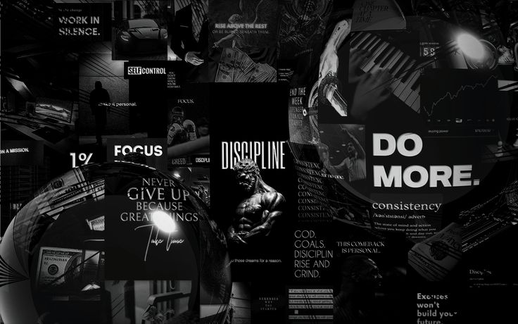
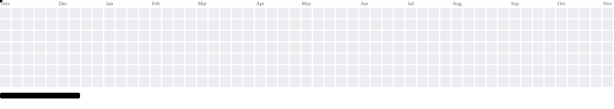

---

## 👨‍💻 About Me

I'm a **Final-Year B.Tech Computer Science Engineering (AIML)** student passionate about building intelligent applications and solving real-world problems through technology.

* 🤖 Interested in Artificial Intelligence and Machine Learning.
* 💻 Enjoy building backend systems and full-stack applications.
* 🧠 Practising Data Structures and Algorithms using Java.
* 🚀 Exploring Agentic AI and intelligent automation.
* 🎯 Focused on becoming a better engineer through consistent learning and building.

 

## 🚀 What I'm Up To

* 🔭 **Currently working on:** AI-Ops Sentinel, VendorSphere and BuildingMind.
* 🤝 **Looking to collaborate on:** AI/ML, backend engineering and full-stack projects.
* 🌱 **Currently learning:** DSA in Java, System Design and Agentic AI.
* 💬 **Ask me about:** Python, Java, Django, FastAPI, Machine Learning and REST APIs.
* 🎯 **Goal:** Build impactful technology and continuously improve as an engineer.

---

## 🎯 Goals

<!-- Upload your landscape goals banner to your repository's assets folder -->

---

## 🛠️ Tech Stack

### Languages & Core Technologies

### AI / Machine Learning

### Backend & Frontend

### Databases & DevOps

### Tools & Monitoring

### Development Environment

---

## 💡 Featured Projects

### 🧠 BuildingMind

**Agentic AI System for Autonomous Energy Optimization in Smart Buildings**

Research focused on occupancy-aware thermal comfort prediction and energy-efficient smart building operations.

* Exploring how occupancy information can support HVAC energy optimization.
* Studying thermal comfort prediction using environmental and occupancy parameters.
* Investigating the relationship between occupant comfort and building energy consumption.

**Focus:** AI/ML · Occupancy Prediction · Thermal Comfort · Smart Buildings

---

### 📊 AI-Ops Sentinel

**Intelligent System Monitoring & Anomaly Detection Platform**

A multi-modal anomaly detection platform designed to correlate logs, metrics and traces in cloud microservices.

* Exploring anomaly detection using VAE-LSTM and Isolation Forest approaches.
* Integrating Prometheus metrics and log analysis.
* Working on explainable anomaly detection and a React monitoring dashboard.

**Tech:** Python · FastAPI · PyTorch · Scikit-learn · React · Prometheus · Grafana · Docker

🔗 [View Repository](https://github.com/raqheeb/AI-Ops-Sentinel)

---

### 🛒 VendorSphere

**Hyperlocal Push-Cart Discovery & On-Demand Delivery Platform**

A hybrid marketplace connecting customers with nearby street vendors.

* Enables customers to discover nearby vendors and request services.
* Supports product browsing, cart management and order placement.
* Explores AI-assisted inventory generation through vendor cart images.

**Tech:** Django REST Framework · React · PostgreSQL · AI Vision API · JWT

🔗 [View Repository](https://github.com/raqheeb/VendorSphere)

---

## 📊 GitHub Statistics

---

## 🎮 Contribution Breakout

<picture>
  <source media="(prefers-color-scheme: dark)" srcset="https://raw.githubusercontent.com/raqheeb/raqheeb/pacman-output/breakout-contribution-graph-dark.svg?game=breakout">
  <source media="(prefers-color-scheme: light)" srcset="https://raw.githubusercontent.com/raqheeb/raqheeb/pacman-output/breakout-contribution-graph.svg?game=breakout">
  
</picture>

---

## 🤝 Let's Connect

---

### ✨ "Consistency turns small efforts into remarkable achievements."

